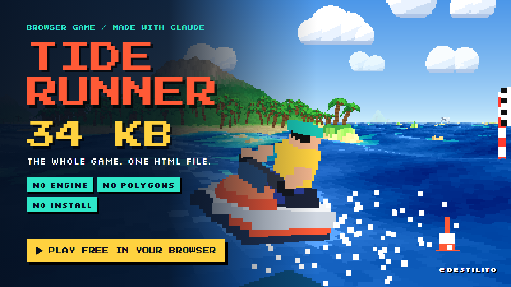
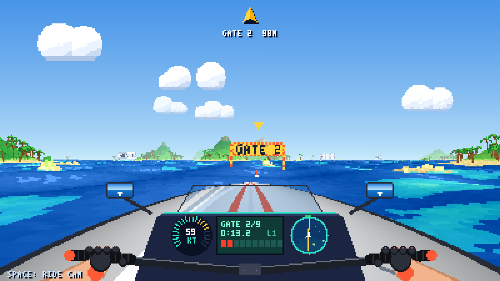

# Tide Runner

A jet ski racer around tropical islands. **The whole game is one 34 KB HTML file**: no engine, no polygons, no libraries, no build step.

**▶ Play:** [destilito.itch.io/tide-runner](https://destilito.itch.io/tide-runner) · [peypau.github.io/tide-runner](https://peypau.github.io/tide-runner/)
Or download `index.html` and double-click it.

## How to ride

| Input | Action |
|---|---|
| Mouse | steer |
| Hold left click / Shift | boost |
| Right click / E | nose up for bigger jumps |
| Space | chase / drone / cockpit camera |
| WASD or arrows | drive with keys |
| R | back to the last gate |

Ride through gates 1-9, then cross the FINISH. Miss a gate and you turn back. Shallows slow you down, waves launch you.

## How it works

- **Voxel Space**, the trick from a 1992 helicopter game: a 1024×1024 heightmap drawn column by column, front to back, with a y-buffer, on a 2D canvas at 400×225 and scaled up 4×.
- Islands, reefs and clouds come from tileable value noise; palms, buoys and clouds are pixel sprites generated in code.
- The jet ski and rider are a ~670-voxel model splatted into the same depth buffer as the terrain.
- The water is a damped buoyancy spring over two moving swells, so at speed the crest drops away and you fly.
- The foam wake is just a timestamp per map cell; the renderer fades it for free.

Built with Claude (Anthropic) by [@destilito](https://x.com/destilito).

## Creator fees

Pump.fun and Bags support sharing creator fees with a GitHub account. If you launch a token inspired by this project and want to credit it, the GitHub account is **Peypau**.
I don't launch, sell or endorse any token. Anything trading under this name was made by someone else.
